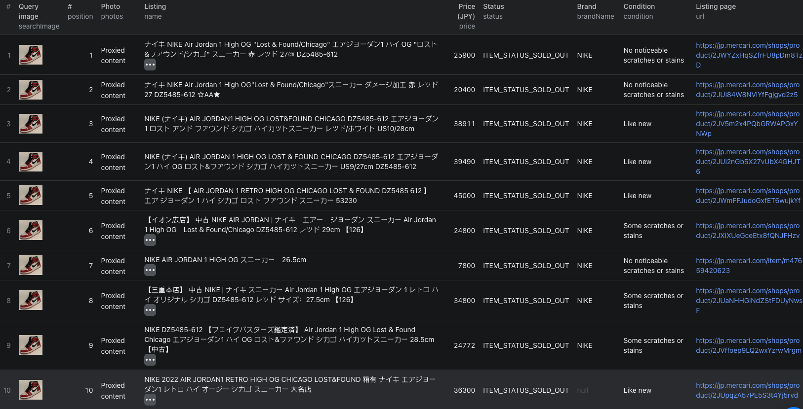

# How to Search Mercari Japan by Image in Node.js

This example shows how to find Mercari Japan listings that match a photo in Node.js using the [Mercari Image Search Scraper](https://apify.com/piotrv1001/mercari-image-search-scraper) Actor on Apify. It calls an existing Actor rather than implementing Mercari's photo search from scratch, and it searches sold listings to get sold comps for the item in the photo.



## What this example does

- Calls `piotrv1001/mercari-image-search-scraper`
- Passes a direct image URL, the sold-listings status filter, and a per-image result limit
- Waits for the Actor run to finish
- Fetches the matching listings from the run's dataset, most similar first
- Prints each structured result

## Prerequisites

- [Node.js](https://nodejs.org) 18 or newer
- An [Apify account](https://console.apify.com/sign-up)
- An Apify API token from **Settings → Integrations**
- Direct JPG, PNG, WebP, GIF, or AVIF URLs no larger than 10 MB

## Installation

```bash
npm install
```

## Environment setup

```bash
cp .env.example .env
```

Add your token to `.env`:

```env
APIFY_TOKEN=your_apify_token_here
```

## Usage

```bash
npm start
```

## Code example

```js
import { ApifyClient } from 'apify-client';
import 'dotenv/config';

// Initialize the ApifyClient with your Apify API token
// Set APIFY_TOKEN in your .env file (copy .env.example to get started)
const client = new ApifyClient({
    token: process.env.APIFY_TOKEN,
});

// Prepare Actor input
const input = {
    imageUrls: [
        'https://upload.wikimedia.org/wikipedia/commons/thumb/2/2a/Nike_Air_Jordan_I.jpg/960px-Nike_Air_Jordan_I.jpg',
    ],
    status: 'sold',
    maxResultsPerImage: 120,
    proxyConfiguration: {
        useApifyProxy: true,
    },
};

// Run the Actor and wait for it to finish
const run = await client.actor('piotrv1001/mercari-image-search-scraper').call(input);

// Fetch and print Actor results from the run's dataset (if any)
console.log('Results from dataset');
console.log(`💾 Check your data here: https://console.apify.com/storage/datasets/${run.defaultDatasetId}`);
const { items } = await client.dataset(run.defaultDatasetId).listItems();
items.forEach((item) => {
    console.dir(item);
});

// 📚 Want to learn more 📖? Go to → https://docs.apify.com/api/client/js/docs
```

## Example output

[`sample-output.json`](./sample-output.json) contains two sold matches from our example run, a Mercari Shops listing and a private seller's listing. Key fields include the query image, similarity position, listing ID and URL, name, price in JPY, status (`ITEM_STATUS_ON_SALE`, `ITEM_STATUS_SOLD_OUT` or `ITEM_STATUS_TRADING`), brand, condition, size, seller or shop ID, photos, listing timestamps, and collection time.

Set `status` to `on_sale` for current listings or `all` for both. `priceMin` and `priceMax` filter by price in yen.

## Use cases

- Price a second-hand item from what similar items sold for on Mercari Japan
- Find who sells a product you only have a photo of
- Compare current asking prices with sold prices before listing
- Match stock photos to Mercari listings without Japanese keywords
- Check how often a model appears in different conditions

## Try the Actor on Apify

**[Open the Mercari Image Search Scraper on Apify](https://apify.com/piotrv1001/mercari-image-search-scraper)**

## Related resources

- [How to Search Mercari Japan by Image and Price Items From Sold Comps](https://www.falconscrape.com/blog/how-to-search-mercari-by-image)
- [Mercari Listings Scraper](https://apify.com/piotrv1001/mercari-listings-scraper)
- [Apify JavaScript client documentation](https://docs.apify.com/api/client/js/docs)

## License

MIT
